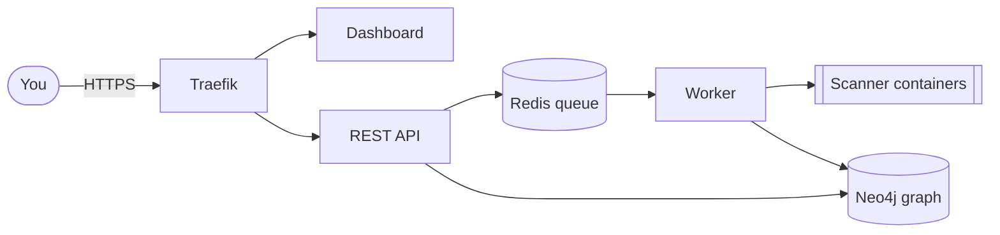

# ASAT — Documentation

**Automated Security Assessment Toolkit (ASAT)**, codebase name **ASAT**
**Provider:** ZELUS · **Service family:** Vulnerability Discovery & Penetration Testing Services

---

## 1. What it is

ASAT runs network and web security assessments from one web dashboard and one REST API. It uses **Nmap, Nikto, ADEnum, Kerbrute** and **FFuF**. Each scan runs in its own Docker container, and results are stored in a **Neo4j** graph so hosts, services and findings are linked, not just listed. Reports can be exported as Markdown or PDF.

| | |
|---|---|
| **You provide** | Authorised targets, a project name, scan settings |
| **You get** | Discovered hosts and services, findings, a graph view, PDF reports |

---

## 2. How you get it

- **On request only.** The tool is delivered by ZELUS to approved users. It is not downloadable from this repository.
- **Hosted locally only.** You run it on your own machine or server. There is no shared or public hosted service.
- **Predefined users.** User accounts are already set up. There is no self-registration.
- **Credentials come with the tool.** Usernames and passwords are delivered to you together with the package. Keep them private and never commit them to a repository.


---

## 3. Authorised use

Scan only systems you have **explicit written permission** to test. Agree the targets, scope and timing with the environment owner and ZELUS before you start. Running in Docker does not replace that permission. Do not publish live targets, credentials or confidential findings.

---

## 4. How it works



1. You start a scan in the dashboard (or the API).
2. The API queues it and returns straight away.
3. A worker starts the scanner in a Docker container and streams its progress.
4. The output is parsed and saved in Neo4j under your project.
5. You view the graph and findings, and export a report.

**Components:** Traefik (entry point), React dashboard, FastAPI backend, Celery worker, Redis, Neo4j, and Keycloak with Postgres for login.

---

## 5. Requirements

- Docker Engine 24+ and Docker Compose v2
- `make`
- 4 GB RAM minimum
- Network access from the host to the targets you are authorised to scan

---

## 6. Install and start

You receive the package and a `.env` file (or its values) from ZELUS. Then:

```bash
make build-all     # build the images
make start         # start everything
```

`make boot-start` does both and shows the logs. Stop with `make stop`.

Open **https://autovam.localhost** (or the host name in the `AUTO_HOST` setting). The services listen on `127.0.0.1` only, so the tool is reachable from the machine it runs on and is not exposed to the network.

If your browser warns about the certificate, it is a local certificate. Trust it as described in your delivery notes, or continue past the warning.

---

## 7. Using it

**Log in** with the credentials delivered with the tool. If you are asked to change a temporary password, do so.

**Create a project.** Every scan belongs to a project. Open the scan panel, type a name and click **Create**.

**Run a scan.**
1. Pick a **tool**.
2. Pick a **scan type**, or **Custom** to enter your own flags. Custom flags must start with `-`.
3. Enter the **target**: an IP address, hostname or range.
4. Click **Run Scan**. Progress shows live.

| Tool | Use it for | Scan types |
|---|---|---|
| Nmap | Host and port discovery, service versions | quick, service_version, vulnerability, os_detection, top_ports, all_ports, custom |
| Nikto | Web server weaknesses | default, Plugins, SSL, custom |
| ADEnum | Active Directory enumeration | needs domain, DC IP, username, password |
| Kerbrute | Kerberos user and password testing | userenum, passwordspray, bruteuser |
| FFuF | Web content discovery | image included, **not yet connected to the dashboard** |

Loopback and link-local addresses (such as `127.0.0.1` and `169.254.x.x`) are blocked as targets.

**View results.** The graph shows hosts, services and findings. Click a node for details. Use **Refresh** after a scan finishes. Severity colours follow CVSS: Critical 9.0–10, High 7.0–8.9, Medium 4.0–6.9, Low 0.1–3.9.

**Create a report.** Select a project, open **Report**, edit the generated Markdown, then **Export PDF**.

**Admin users** can also add, edit and remove users, and set which tools each user may run.

---

## 8. Roles and access

| Role | Can do |
|---|---|
| **user** | Run the tools they are allowed, see their own projects |
| **admin** | Everything, including all projects and user management |

Users only see projects they created. Admins see all projects.

---

## 9. REST API (summary)

Base path: `https://<AUTO_HOST>/back` · Interactive docs: `/back/docs` · Log in first; the API uses session cookies.

| Method | Path | Purpose |
|---|---|---|
| POST | `/auth/login` | Log in |
| POST | `/create_project` | Create a project |
| GET | `/projects` | List your projects |
| POST | `/nmap/scan` | Start an Nmap scan |
| POST | `/nikto/scan` | Start a Nikto scan |
| POST | `/adenum/scan` | Start an ADEnum scan |
| POST | `/kerbrute/scan` | Start a Kerbrute scan |
| GET | `/scan/progress?run_id=` | Scan status |
| GET | `/scan/stream/{run_id}` | Live log stream |
| GET | `/graph?project=` | Graph data |
| GET | `/logs?project_id=` | Action log |
| GET | `/get_findings?project=` | Markdown findings report |
| POST | `/report/upload_md_to_pdf` | Markdown to PDF |
| DELETE | `/delete_project` | Delete a project |

Scan requests return `202` with a `task_id` (and a `run_id` for Nmap and Nikto). Admin-only routes live under `/admin/users`.

---

## 10. Settings (`.env`)

Delivered with the tool. Keep this file private.

| Setting | Meaning |
|---|---|
| `AUTO_HOST` | Host name for the dashboard (default `autovam.localhost`) |
| `NEO4J_USER`, `NEO4J_PASS` | Graph database login |
| `ADMIN_USERNAME`, `ADMIN_PASSWORD` | Predefined admin account |
| `JWT_SECRET_KEY`, `JWT_REFRESH_SECRET_KEY` | Session signing keys |
| `REDIS_PASSWORD` | Queue password |
| `POSTGRES_*`, `KEYCLOAK_*` | Login service settings |
| `FLOWER_USER`, `FLOWER_PASSWORD` | Task monitor login |

---

## 11. Everyday commands

| Command | Purpose |
|---|---|
| `make start` / `make stop` | Start or stop |
| `make logs` | All logs |
| `make logs-back` | API logs |
| `make logs-worker` | Scan worker logs |
| `make help` | All commands |

Data is kept in Docker volumes and survives a restart. Removing the volumes (`docker compose down -v`) deletes all projects, results and users.

---

## 12. Troubleshooting

| Problem | Fix |
|---|---|
| Certificate warning | Local certificate. Trust it or continue. |
| Cannot log in | Use the credentials delivered with the tool. |
| "Not authenticated" | Session expired. Log in again. |
| Scan stuck at 0% | Run `make logs-worker`. |
| Empty graph | Wait for the scan to finish, click **Refresh**. |
| Keycloak not ready | Wait about 30 seconds and run `make start` again. |
| Port 80 or 443 in use | Stop the other service using it. |
| Build error `GID already exists` (Mac) | `make build-all DOCKER_GID=998` |

---

## 13. Limits

- Local hosting only, for approved users.
- Needs explicit authorisation for every target.
- Repository documentation, hosted access, API access and downloadable software are separate arrangements. Follow the project, Open Call and provider terms.

---


